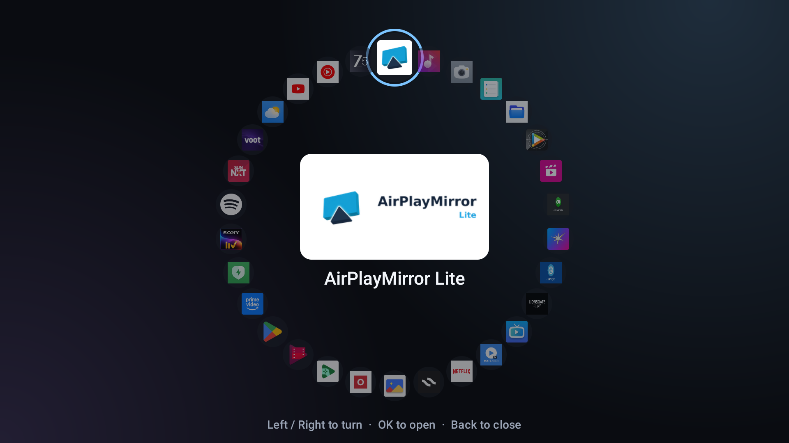
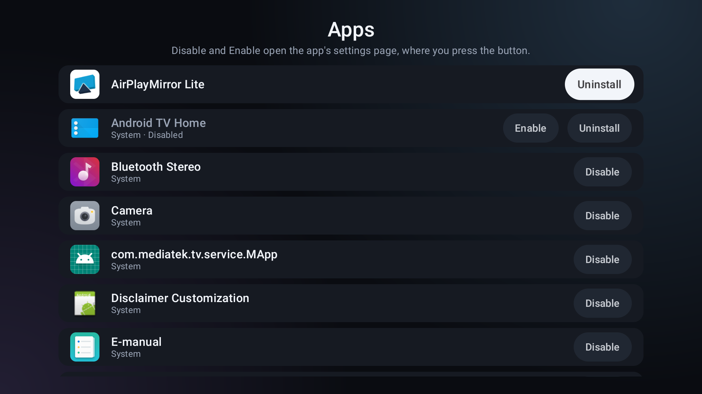
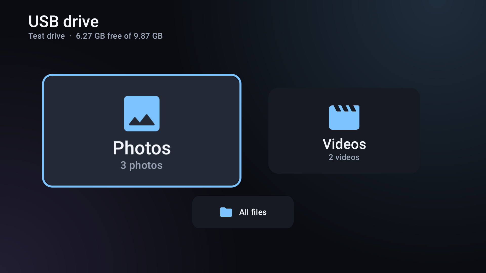
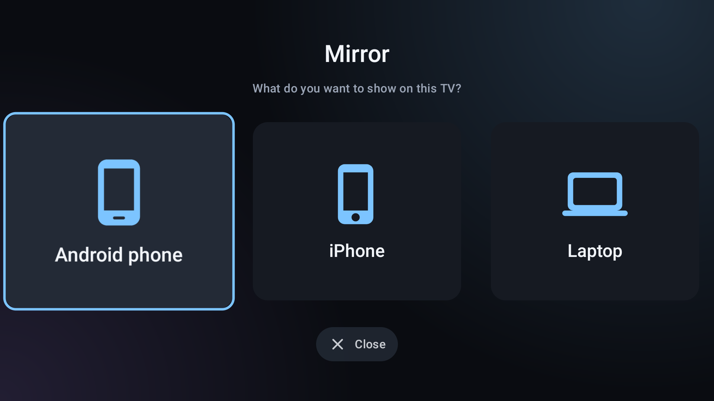
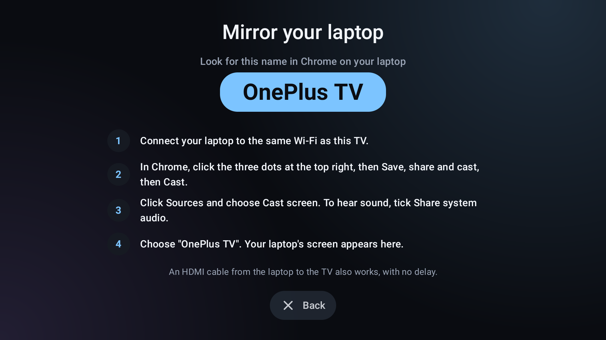
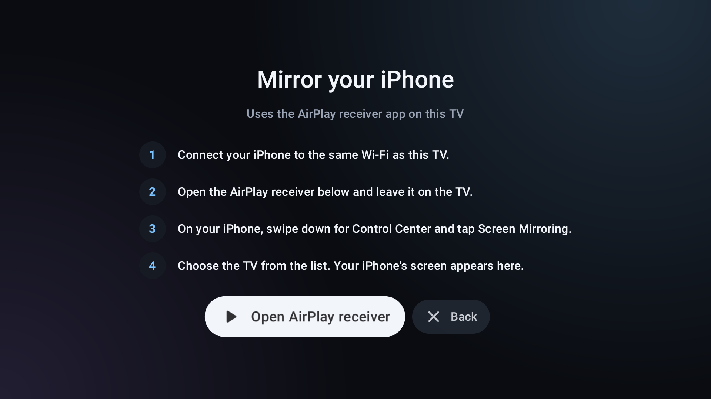

# iControl

A custom Android TV home launcher built with Kotlin and Compose for TV. It has a clean, large, easy-to-read layout for elderly users: the focused item grows 1.3x, rows are centred, and the text is big.

Built for a OnePlus TV (Android 11, 1080p), but it should work on any Android TV device.

## Screenshots

| Home screen (favorite app focused) | System row |
| --- | --- |
|  |  |

| All apps (rotating ring) | Apps manager |
| --- | --- |
|  |  |

| USB drive menu |
| --- |
|  |

### Mirror

| Choose what to mirror | Laptop guide | iPhone guide |
| --- | --- | --- |
|  |  |  |

The USB screenshot uses synthetic test files, not a real drive. The Wi-Fi name is not shown in the mirror screenshots because they were taken without the location permission, so the guides use their generic wording ("the same Wi-Fi as this TV"). On the TV the guides show the real network name.

## Features

- **Home screen:** big, focus-friendly tiles in three rows: Inputs, Favorite apps and System. The TV's memory use is shown at the top right.
- **Inputs:** HDMI, DTH, the sound bar and other TV inputs, opened in one press. Long-press an input to mark it as the sound bar (see below).
- **Favorite apps:** pick which apps appear on the home row. A per-app menu offers remove, app info and uninstall.
- **All apps:** a rotating ring of every installed app.
- **System row:** USB, Mirror, Apps, Wi-Fi, Sound and Settings.
- **Apps manager:** every app on the TV in one list, with the actions that apply to each (see below).
- **USB:** browse photos, videos and all files on a USB drive, with photo and video counts. Photos and videos each have a grid with Play all / Slideshow controls: **From here**, **From start**, **Random** and **Loop** (see below).
- **Mirror:** asks Android phone, iPhone or laptop, then guides the user through mirroring (see below).
- **Sound bar reconnect:** brings an HDMI ARC sound bar back when the link has dropped (see below).
- **Home button:** pressing Home from any app, including the mirror receiver, closes any open dialog and shows the landing page.

## Mirror

The Mirror tile first asks what you want to show on the TV, using three equal cards.

- **Android phone:** uses the TV's built-in Google Cast receiver. The guide shows the TV's name and the Wi-Fi network, and says where to tap on the phone (Cast, Smart View or Screen mirroring).
- **iPhone:** iPhone mirroring uses AirPlay, which Android TV does not include, so the TV needs a free AirPlay receiver app. iControl does not contain a receiver itself. It opens the receiver and walks through the iPhone's side: connect to the same Wi-Fi, open the receiver, then Control Center, Screen Mirroring, and choose the TV.
- **Laptop:** uses the same Google Cast receiver, through Chrome's Cast (Save, share and cast, then Cast, then Cast screen). This works on Windows, Mac and Chromebook. The guide also mentions an HDMI cable as a no-delay alternative.
- **Receiver not installed (iPhone):** the guide shows a **Get it on Google Play** button that opens the receiver's Play Store page, plus a hint to search for it by name if there is no Play Store. When you return after installing, the button changes to **Open AirPlay receiver**.

The supported receiver is **AirPlayMirror Lite** (`com.neoyantra.airplaymirror.airplaymirrorappdemo`). To support another receiver, add its package name to `AirPlayReceivers` in `ui/MirrorGuideDialog.kt`.

Protected video, such as Netflix, usually shows black over AirPlay.

## Apps manager

The **Apps** tile lists every app with a launcher entry, every app you installed, and every disabled app (a disabled app loses its launcher entry, so it is listed so it can be enabled again). Each row shows only the actions that apply:

- **Disable** for system apps that are on, **Enable** for disabled apps. Android only lets the system change another app's enabled state, so these open the app's settings page, where you press the real button.
- **Uninstall** for apps you installed, and for system apps that have an update installed (this rolls the update back). A plain system app cannot be uninstalled.

The list is rebuilt when you come back from one of those screens.

## USB photos and videos

The photo and video grids use the same layout: rows of thumbnails, with the focused row kept at the vertical middle, level with the fixed buttons on the left.

- **From here:** plays from the first item of the row beside the button.
- **From start:** plays from the first item.
- **Random:** starts straight away with every item in a shuffled order.
- **Loop:** a checkbox; the list starts over after the last item. It is on by default for photos and off for videos.

Opening a single photo or video still shows or plays just that one (a video repeats if Loop is on).

## Sound bar reconnect

An HDMI ARC sound bar can drop into standby after a while, and the TV then never brings the ARC link back (restarting the TV does). iControl works around this without any system permission:

- On a Home press, and when iControl starts, it checks whether the TV is sending audio out over ARC.
- If it is not, it tunes to the sound bar's HDMI input. That makes the TV wake the bar and set ARC up again. It waits for ARC to come back (up to 10 seconds) and returns to the launcher.
- It tries at most once every 2 minutes, so a bar that is switched off on purpose does not pull the screen away on every Home press.

The sound bar's input is the one you mark with a long-press on an input tile (the marked input shows a speaker icon). If you never chose, iControl uses the only input whose name looks like a sound bar (speaker, sound, bar, arc, audio).

An app cannot send HDMI-CEC commands itself (that needs a system-only permission), so tuning to the input is the way this is done.

## Requirements

- Android Studio or JDK 17+ with the Android SDK (compileSdk 37)
- Gradle wrapper included (AGP 9.4.1, Kotlin 2.4.21)
- An Android TV with ADB over network enabled

## Build

```powershell
.\gradlew.bat :app:assembleRelease
```

The release build is signed with the debug key, so it installs directly.

## Install and run

```powershell
adb connect <tv-ip>:5555
adb install -r app\build\outputs\apk\release\app-release.apk
adb shell am start -n dev.mahesh.icontrol/.MainActivity
```

## Making it the default home app

The stock launcher registers HOME at a higher priority than non-system apps, so setting the home activity alone is ignored. Disable the stock launcher:

```powershell
adb shell pm disable-user --user 0 com.google.android.tvlauncher
```

To undo it:

```powershell
adb shell pm enable com.google.android.tvlauncher
```

The system FallbackHome acts as a safety net if iControl fails to start.

## Notes

- `targetSdk` is 29 on purpose, so the USB drive is readable without an "all files access" settings screen.
- `UsbStorage.TEST_ROOT_ENABLED` must be `false` in committed code. It is a test hook that points the USB reader at `/sdcard/iControlUsbTest`, for taking screenshots with synthetic files.
- The Wi-Fi name in the mirror guide needs location permission (Android requires it to read the network name). Without it, the guide says "the same Wi-Fi as this TV" instead.
- The Apps manager needs the `QUERY_ALL_PACKAGES` permission to list disabled apps and apps without a launcher entry.
- The TV's memory use comes from `ActivityManager`. There is no CPU figure: Android 11 stops apps reading `/proc/stat`.
- Do not commit screenshots of the USB drive's photos or videos, or of the Wi-Fi name.

## Project layout

```
app/src/main/java/dev/mahesh/icontrol/
  MainActivity.kt, LauncherViewModel.kt   entry point, state, sound bar reconnect
  data/                                   app list, preferences, sound bar link check
  ui/                                     home screen, dialogs (all apps, apps manager, mirror guide, sound bar), theme
  usb/                                    USB browser (files, photos, videos, slideshow and playback)
docs/screenshots/                         images used in this README
```

## License

iControl is released under the [MIT License](LICENSE).

It does not include or modify any AirPlay receiver code. The AirPlay receiver (AirPlayMirror Lite by NeoYantra) is a separate app that you install yourself, and it has its own terms. App names and logos shown in screenshots (Netflix, JioHotstar, Zee5, Prime Video, YouTube and others) belong to their owners.

Libraries used: AndroidX, Jetpack Compose, Compose for TV, Media3 and Coil, all under the Apache License 2.0.
