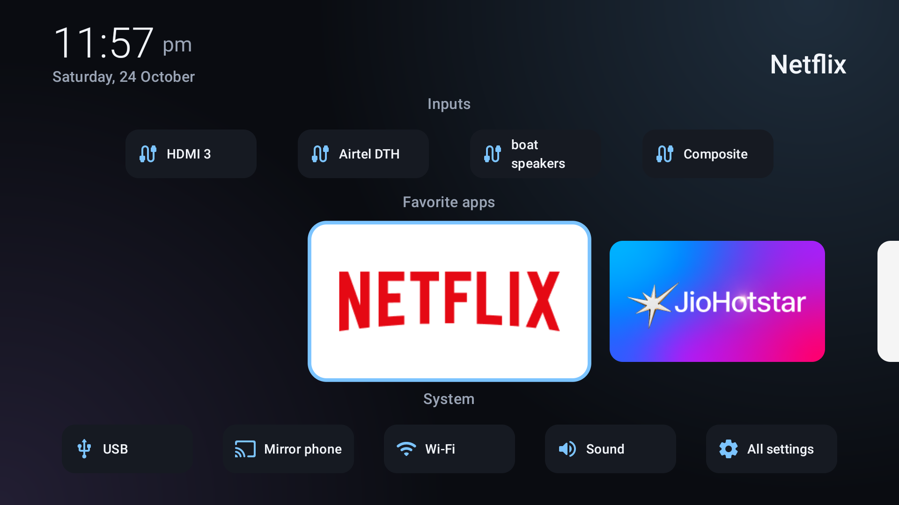
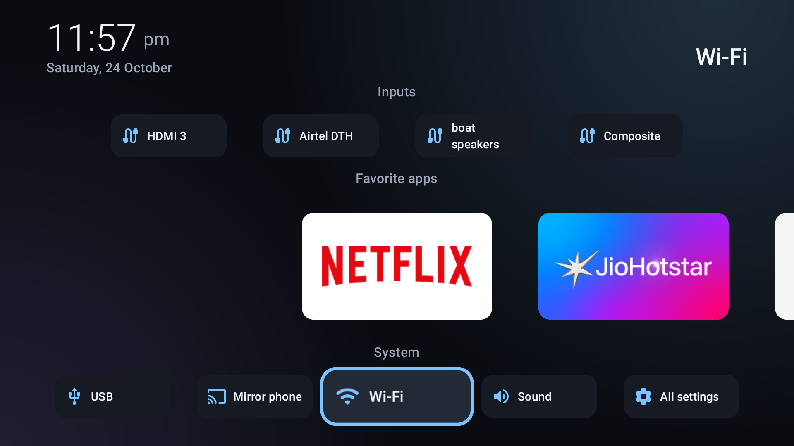

# iControl

A custom Android TV home launcher built with Kotlin and Compose for TV. It has a clean, large, easy-to-read layout for elderly users: the focused item grows 1.3x, rows are centred, and the text is big.

Built for a OnePlus TV (Android 11, 1080p), but it should work on any Android TV device.

## Screenshots

| Favorite apps focused (tile grows 1.3x) | System row focused |
| --- | --- |
|  |  |

## Features

- Home screen with big, focus-friendly app tiles
- All-apps view, per-app menu, and app picker to customise the home row
- USB storage browser for photos, videos and files
- Screen mirroring guide

## Requirements

- Android Studio or JDK 17+ with the Android SDK (compileSdk 37)
- Gradle wrapper included (AGP 9.4.1, Kotlin 2.4.21)
- An Android TV with ADB over network enabled

## Build

```powershell
.\gradlew.bat :app:assembleRelease
```

The release build is signed with the debug key, so it installs directly.

## Install and run

```powershell
adb connect <tv-ip>:5555
adb install -r app\build\outputs\apk\release\app-release.apk
adb shell am start -n dev.mahesh.icontrol/.MainActivity
```

## Making it the default home app

The stock launcher registers HOME at a higher priority than non-system apps, so setting the home activity alone is ignored. Disable the stock launcher:

```powershell
adb shell pm disable-user --user 0 com.google.android.tvlauncher
```

To undo it:

```powershell
adb shell pm enable com.google.android.tvlauncher
```

The system FallbackHome acts as a safety net if iControl fails to start.

## Notes

- `targetSdk` is 29 on purpose, so the USB drive is readable without an "all files access" settings screen.
- `UsbStorage.TEST_ROOT_ENABLED` must be `false` in committed code. It is a test hook that points the USB reader at `/sdcard/iControlUsbTest`.

## Project layout

```
app/src/main/java/dev/mahesh/icontrol/
  MainActivity.kt, LauncherViewModel.kt   entry point and state
  data/                                   app list and preferences
  ui/                                     home screen, dialogs, theme
  usb/                                    USB browser (files, photos, videos)
```
