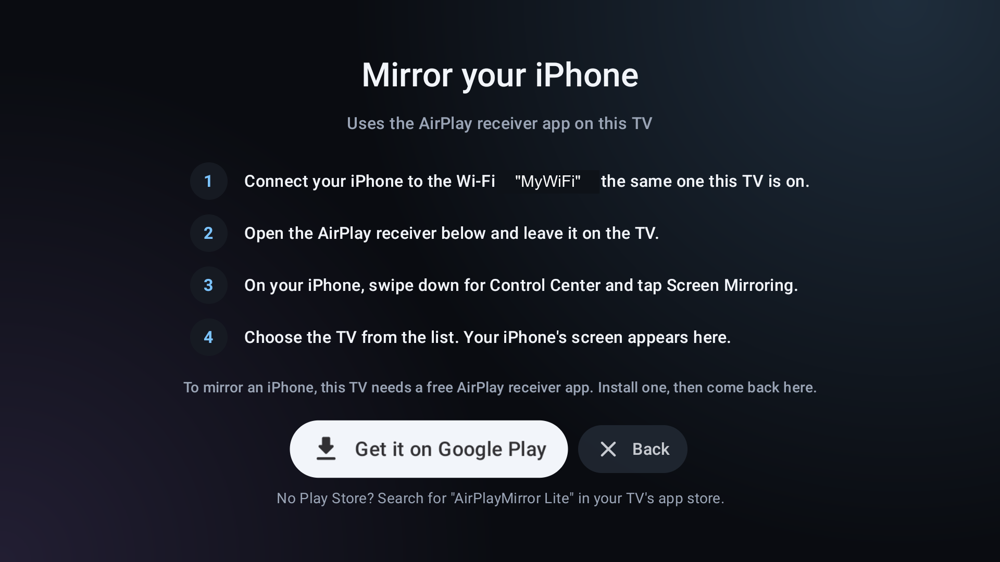

# iControl

A custom Android TV home launcher built with Kotlin and Compose for TV. It has a clean, large, easy-to-read layout for elderly users: the focused item grows 1.3x, rows are centred, and the text is big.

Built for a OnePlus TV (Android 11, 1080p), but it should work on any Android TV device.

## Screenshots

| Favorite apps focused (tile grows 1.3x) | System row focused |
| --- | --- |
|  |  |

| All apps (rotating ring) | USB drive menu |
| --- | --- |
|  |  |

### Mirror phone

| Choose your phone | iPhone guide (receiver installed) |
| --- | --- |
|  |  |

| iPhone guide (receiver not installed) |
| --- |
|  |

The Wi-Fi name in the iPhone screenshots is replaced with a placeholder. On the TV it shows the real network name.

## Features

- **Home screen:** big, focus-friendly tiles in three rows: Inputs, Favorite apps and System.
- **Inputs:** HDMI, DTH, Bluetooth speakers and other TV inputs, opened in one press.
- **Favorite apps:** pick which apps appear on the home row. A per-app menu offers remove, app info and uninstall.
- **All apps:** a rotating ring of every installed app.
- **USB:** browse photos, videos and all files on a USB drive, with photo and video counts.
- **Mirror phone:** asks Android or iPhone, then guides the user through mirroring (see below).
- **Home button:** pressing Home from any app, including the mirror receiver, closes any open dialog and shows the landing page.

## Mirror phone

The Mirror phone tile first asks which phone you have.

- **Android phone:** uses the TV's built-in Google Cast receiver. The guide shows the TV's name and the Wi-Fi network, and says where to tap on the phone (Cast, Smart View or Screen mirroring).
- **iPhone:** iPhone mirroring uses AirPlay, which Android TV does not include, so the TV needs a free AirPlay receiver app. iControl does not contain a receiver itself. It opens the receiver and walks through the iPhone's side: connect to the same Wi-Fi, open the receiver, then Control Center, Screen Mirroring, and choose the TV.
- **Receiver not installed:** the guide shows a **Get it on Google Play** button that opens the receiver's Play Store page, plus a hint to search for it by name if there is no Play Store. When you return after installing, the button changes to **Open AirPlay receiver**.

The supported receiver is **AirPlayMirror Lite** (`com.neoyantra.airplaymirror.airplaymirrorappdemo`). To support another receiver, add its package name to `AirPlayReceivers` in `ui/MirrorGuideDialog.kt`.

Protected video, such as Netflix, usually shows black over AirPlay.

## Requirements

- Android Studio or JDK 17+ with the Android SDK (compileSdk 37)
- Gradle wrapper included (AGP 9.4.1, Kotlin 2.4.21)
- An Android TV with ADB over network enabled

## Build

```powershell
.\gradlew.bat :app:assembleRelease
```

The release build is signed with the debug key, so it installs directly.

## Install and run

```powershell
adb connect <tv-ip>:5555
adb install -r app\build\outputs\apk\release\app-release.apk
adb shell am start -n dev.mahesh.icontrol/.MainActivity
```

## Making it the default home app

The stock launcher registers HOME at a higher priority than non-system apps, so setting the home activity alone is ignored. Disable the stock launcher:

```powershell
adb shell pm disable-user --user 0 com.google.android.tvlauncher
```

To undo it:

```powershell
adb shell pm enable com.google.android.tvlauncher
```

The system FallbackHome acts as a safety net if iControl fails to start.

## Notes

- `targetSdk` is 29 on purpose, so the USB drive is readable without an "all files access" settings screen.
- `UsbStorage.TEST_ROOT_ENABLED` must be `false` in committed code. It is a test hook that points the USB reader at `/sdcard/iControlUsbTest`.
- The Wi-Fi name in the mirror guide needs location permission (Android requires it to read the network name). Without it, the guide says "the same Wi-Fi as this TV" instead.
- Do not commit screenshots of the USB drive's photos or videos, or of the Wi-Fi name.

## Project layout

```
app/src/main/java/dev/mahesh/icontrol/
  MainActivity.kt, LauncherViewModel.kt   entry point and state
  data/                                   app list and preferences
  ui/                                     home screen, dialogs (all apps, mirror guide), theme
  usb/                                    USB browser (files, photos, videos)
docs/screenshots/                         images used in this README
```
